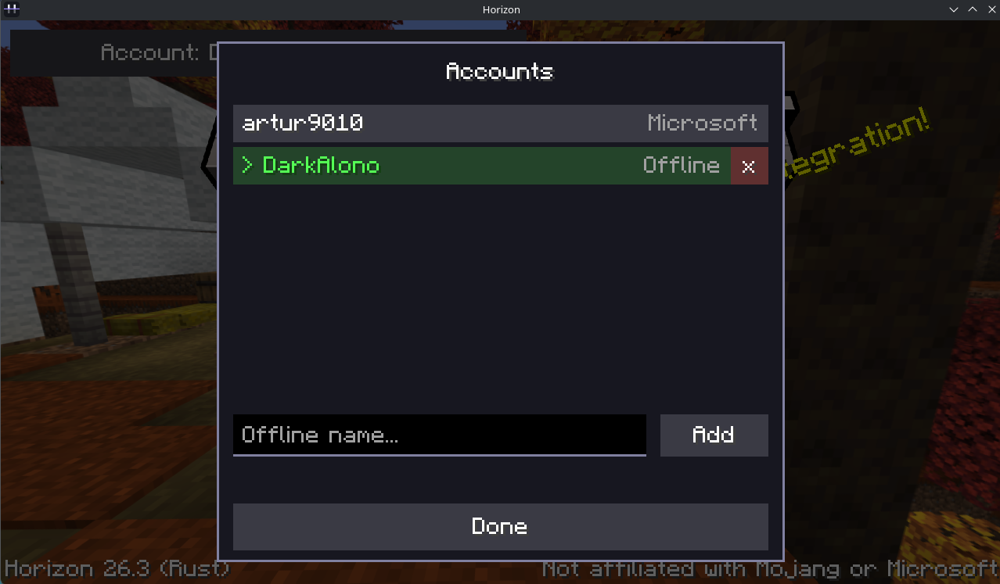

# Horizon Switcher (native mod for Horizon)

An in-game account switcher for [Horizon](https://github.com/horizon-rust/horizon), in the spirit of Java's
In-Game Account Switcher: keep a list of **offline accounts** next to your Microsoft account and switch between
them on the title or multiplayer screen, with no restart.



## Why this mod exists

Horizon's launcher used to have offline names. On 2026-11-09
[horizon-rust/horizon#14127](https://github.com/horizon-rust/horizon/pull/14127) ("launcher: remove offline names;
play only as an account that owns the game") removed them, with their skins and capes, the hidden developer
option, and the CLI's offline account commands. Since then the game plays only as a Microsoft account that owns
Minecraft: Java Edition. This mod puts offline accounts back, inside the game, behind that same Microsoft account.

## You still need a Microsoft account that owns the game

Horizon's launcher only starts the game for a Microsoft account that owns Minecraft: Java Edition, and hands that
session to the game. Offline accounts work **only while that session is there**. Start the game any other way and
the list is shown greyed out with "Start Horizon from the launcher with a Microsoft account". The mod adds offline
names; it does not get around buying the game.

Offline names only get into **offline-mode** servers (and LAN / single player). Online-mode servers refuse them, as
they do on Java.

## Install

From the launcher: **Mods → Add from GitHub** and paste this repository's URL, or:

```sh
horizon-launcher mods add-github https://github.com/artur9010/HorizonSwitcher --trust-native-code
```

The launcher pins the latest commit (or release), packs `mixins/horizon_switcher/` into a `.hnmod`, and builds a
modded game for your instance. Native mods run with full access to your computer: read the source first.

The mod is pinned to one Horizon Nightly (`[compatibility]` in `horizon-mixin.toml`, mirrored in
`compatibility.json`). A daily workflow moves the pin to each new Nightly that the mod builds on, and releases it. On another
Horizon the launcher asks before building (**Build anyway**).

### From a file

`python3 tools/package.py` writes `target/horizon_switcher-<version>.hnmod`. Put it in the instance's
`horizon-native-mods/` folder, next to `options.txt`, and let the launcher build. This is a native mod, so it is
an `.hnmod`, not an `.hmod`: `.hmod` content mods can't carry code.

## Use

* **Account: <name>** button, top left of the title and multiplayer screens. It opens the list.
* Click a row to play as it: the Microsoft account, or an offline name (marked green with `>`).
* Type a name (3–16 of `A-Z a-z 0-9 _`; Shift+`-` types `_`) and press **Add** or Enter. It is added and selected.
* **x** removes an offline name. Removing the active one switches back to Microsoft.
* **Done**, Escape or a click outside closes it.

The choice is saved and comes back the next time you start the game. Files:

* `$HORIZON_HOME/horizon-switcher.json`: the offline names and which one plays. It is shared by every instance.
  No tokens are stored; the Microsoft session stays in the game's memory as before.

## How it hooks in

| Injection | Where | What |
|---|---|---|
| `[[module]] account_switcher` | `horizon-client-render/src/auth.rs` (pub) | State, account file, overlay layout/input, server-list add |
| `current` (HEAD, cancellable) | `auth::current` | Returns no session while an offline account plays: joins, LAN, single player, chat signing and Realms all go offline |
| `player-name` (HEAD, cancellable) | `game::Options::player_name` | The offline name wherever the game names its player (splitscreen guests untouched) |
| `listed` | named hook `mods` | Row in Options → Mods |
| `render`, `press`, `release`, `scroll`, `key` | named screen hooks (API 326 title screens) | Draw the button and overlay, take its clicks, wheel and typing |

`switcher.rs` is pure Rust except for `super::CURRENT`, `crate::logging` and `horizon_protocol::servers`, which
`shim/` stands in for, so its logic has unit tests without the game:

```sh
cargo test
```

`cargo test` covers the logic only (the name rules, saving the list, layout and clicks, key mapping, adding the
server once). I have not compiled the mod into a full Horizon build. The launcher's build is the real check: it runs
horizon-mixins and compiles the game with it.

## Maintenance

| Workflow | When | What |
|---|---|---|
| `ci.yml` | push, PR | `cargo test`, clippy, and `tools/verify.sh`: the real horizon-mixins `plan` + `apply` on the pinned Horizon |
| `bump-horizon.yml` | daily, or by hand (optionally with a commit) | `tools/bump_horizon.py` picks the newest `nightly-source/*` tag and checks every named hook. Hooked functions that only moved are rewritten to their new path. It takes the launcher's horizon-mixins revision and runs `tools/verify.sh --compile`. **If that passes**, it commits the new pin to `master`, raises the patch version (`tools/bump_version.py`), tags `v<version>` and publishes the release. If it fails, `master` is unchanged and an issue is opened. |
| `release.yml` | tag `v<version>`, or called by the bump | Checks that the tag matches the version, tests, applies and compiles (skipped when the bump already did), then `tools/package.py` and a GitHub release with the `.hnmod` |

To release by hand: `python3 tools/bump_version.py` (patch +1, or pass a version), commit, then
`git tag v<version> && git push origin master --tags`.

The bump pushes with the workflow's own token, so `master` must accept pushes from GitHub Actions; branch
protection that requires PRs would block it. A tag pushed with that token starts no workflow, so the bump calls
`release.yml` itself.

## Credit

Inspired by In-Game Account Switcher
for Java. Its features are reimplemented here; none of its code or assets are used. Layout modelled on
[ResourcifyHorizon](https://github.com/tariksabanuz/ResourcifyHorizon).
